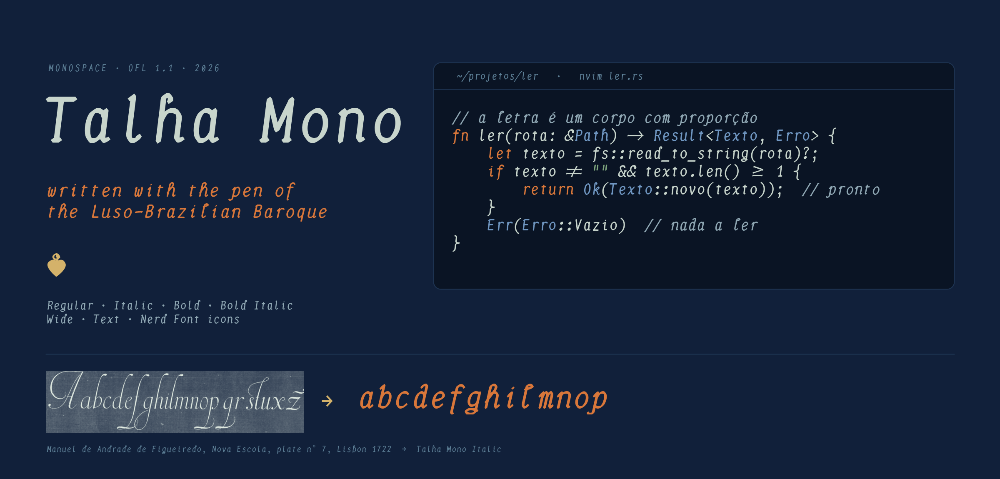
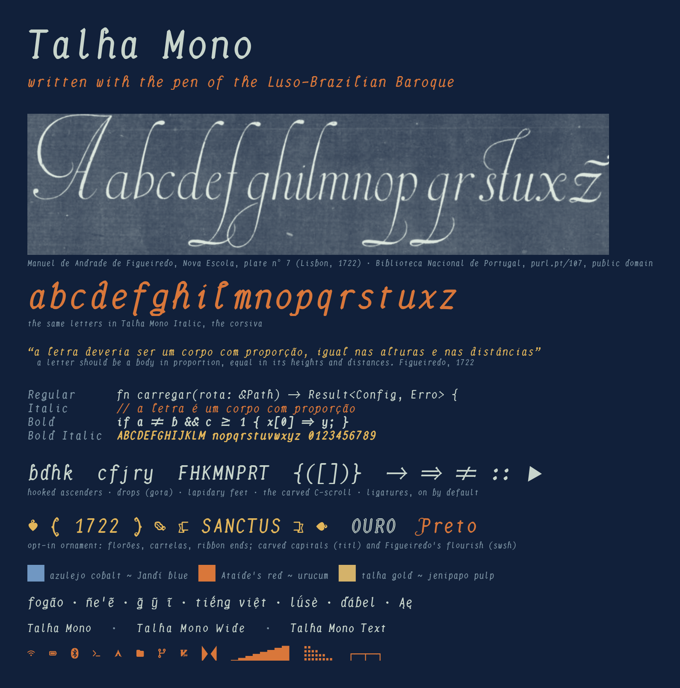

# Talha Mono

A monospaced font for terminals and desktops, **written with the pen of the
Luso-Brazilian Baroque.** Its letters come from the writing master Manuel de
Andrade de Figueiredo (*Nova Escola*, 1722); its ornament from the *rococó
mineiro* of Aleijadinho and Manuel da Costa Ataíde. Made for the
[Jandí theme for Omarchy](https://github.com/arnaudmatheus/omarchy-jandi-theme).

The name is *talha*, the gilded wood carving of the churches of Minas Gerais,
where its ornament comes from. Until 1.0.0-beta.2 it was called Jandí Mono.



## The inspiration: Barroco e Rococó

**Manuel de Andrade de Figueiredo** was born in the Captaincy of Espírito
Santo, Brazil, and taught writing in Lisbon. His *Nova Escola para aprender a
ler, escrever e contar* (1722) is a book of engraved writing models. Within a
few years, his models ornamented the statute books (*Compromissos*) of the lay
brotherhoods of Minas Gerais (Almada 2011, 2012). Talha Mono takes its
letters from two of his plates:
- **Plate nº 9, his calm everyday hand, for the Regular:** ascenders that
  curl over to the right and close in a ball, round open bowls, and the ball
  terminal (*gota*, the drop) on `c f j r y`.
- **Plate nº 7, the *cursiva*, for the Italic:** looped `h k l`, the
  bastarda `d` curling back to the left, the *rasgo* (flourish) under `p`,
  and long lead-ins and exits.

He wrote a brief that fits a monospace exactly: *"a letra deveria ser um corpo
com proporção, perfeito, igual nas alturas e nas distâncias"*. In English: a
letter should be a body in proportion, equal in its heights and its
distances.

**The *rococó mineiro*** is the art of the gold towns of Minas Gerais at the
turn of the 19th century. It gives the font its ornament:
- **Aleijadinho (Antônio Francisco Lisboa):**
  - **Lapidary feet** on the capitals, after the inscriptions cut in stone on
    church portals.
  - **Carved scroll capitals and *rocalha* fleurons**, after his soapstone
    portal of São Francisco de Assis in Ouro Preto.
  - **Banner ends**, after the Latin inscription scrolls held by his Twelve
    Prophets at Congonhas (1800–1805).
- **Manuel da Costa Ataíde:** **frames for brackets**, after the painted
  cartouches of his nave ceiling at São Francisco de Assis (1801–1812).
- **All of it is in the font now.** The letters, feet, drops, punctuation
  and C-scroll braces are in default text. The capitals, fleurons, frames
  and ribbon ends are opt-in ornament (see [Ornament](#ornament-opt-in)) and
  never touch default text.

**The rule above all of it: ornament never costs legibility.** Hard-to-read
fonts don't help memory; that research failed to replicate, as the
references below show. So every Baroque form goes through a measurement
harness, and nothing ships that makes an easily confused pair (`r/n`,
`l/1/I`, `c/o`, `:/;`…) harder to tell apart.

## What it is

Every letter is a centreline swept by **one cut nib held at one fixed angle
(35°)**. Thick and thin are never drawn by hand; they fall out of the pen
angle, the same for every letter. The hand lifts between letters (no joins),
which is exactly what a monospace grid needs. Under the pen, Talha Mono is
built on **Monaspace Radon**, which supplies its vertical metrics, box
drawing, symbol set and OpenType machinery.

- **Subtle contrast** (≈1.6 : 1), so hairlines survive small sizes on a
  96 PPI screen.
- **Figueiredo's letters:**
  - The Regular has his hooked ascenders with a ball, drops on `c f j r y`,
    and lapidary feet on `F H K M N P R T`.
  - The Italic is his *corsiva*, leaning 13° against the Regular's 7°, so
    comments read apart from code by shape as well as by angle.
  - A chancery `f` with a descender, and a `g` whose looped descender closes
    in one sweep.
- **Punctuation with the pen:**
  - The period, comma, colon, `!` and `?` are built from one teardrop
    (*gota*).
  - Braces are a carved C-scroll with a pointed middle.
  - Code symbols and ligatures keep Radon's geometry, so `==` and `->` still
    join across cells, but are re-stroked with the same nib as the letters.
- **Ligatures on by default:** `-> => != == === <= >= |> :: ...` and the rest
  of Radon's set need no feature flag. To turn them off, disable `liga` (for
  example `font-feature = -liga` in Ghostty); texture healing keeps working.
- **Measured legibility:** a harness (`tools/measure.py`, results in
  [docs/metrics.md](docs/metrics.md)) checks every change. Distinct
  confusables:
  - a flagged and footed `1`, an `l` with a sweeping tail, a serifed `I`
  - a slashed `0` narrower than `O`
  - a notched `a` against a round `o`
  - `f` and `j` with hooks of different sizes
- **A taller x-height than Radon** (+5%), so 12 pt clears the ≈0.2° critical
  print size of reading research on a typical desktop monitor.
- **Writes Tupi and Guarani correctly.** Radon has no mark positioning, so
  `g` + U+0303 leaves the tilde floating beside the `g`. Talha Mono adds GPOS
  mark attachment, so these all sit right:
  - `g̃ G̃ ỹ ĩ ũ ẽ`
  - Vietnamese stacks
  - stacked Pinyin accents (`ǘ ǚ`)
  - the Czech/Slovak apostrophe carons (`ď ľ ť Ľ`)
- **Texture healing re-derived for these letters:** narrow letters step
  aside next to wide ones by amounts measured on Talha's own shapes. Spacing
  is more even than Radon's.
- **A tighter cell than Radon:** 1160 units (0.58 em) instead of 1240, so the
  narrow pen letters don't float apart. Box drawing still meets edge to edge.
- **Smooth, hinted outlines:** the pen's strokes are fitted back into Bézier
  curves and hinted with Adobe's autohinter, so text is crisp at 12 px and
  smooth at any size.
- Regular, Bold, Italic, Bold Italic, in a normal and a Wide cell, plus a
  heavier Text weight.

### How it got here

Versions 0.1–0.3 began as Radon's cursive redrawn with a Renaissance chancery
pen. That direction was prompted by Microsoft's **Michelangelus**, and the
chancery `f` and the one-sweep `g` come from that stage. From 0.4.0 the base
is our own reading of the Luso-Brazilian Baroque and the *rococó mineiro*.
Michelangelus is not a source of this font: no outlines, measurements or data
from it were ever used, which its licence forbids.

## Reading size

Reading slows down sharply once the x-height drops below about 0.2° of
visual angle, the critical print size (Legge & Bigelow, 2011). What that
means in points depends on the screen and how far you sit from it:

| Screen | Distance | x-height at 12 pt | Read long text at |
|---|---|---|---|
| 24–27" monitor, ~97 PPI | 60 cm | 0.216° | 12 pt or more |
| Laptop, ~197 PPI at 1.25× scaling | 50 cm | 0.160° | 15 pt or more |

For code that you scan rather than read, smaller is fine. For notes, docs
and long comments, stay above the line. `docs/metrics.md` has the visual
angle for each release.

To find the face you read fastest in, use the
[reading test](https://claude.ai/artifact/XDD6j8zVNS581xVPPGP3Lz): blind,
counterbalanced passages in Talha Mono, Wide, Text and Radon, with a
comprehension check on each. The link opens only for people it's been
shared with.

## Ornament (opt-in)

Nothing here appears in normal text. Type the characters, or ask for the
features:

- **Florões**, after the scrolls of Aleijadinho's carving: `❦ ❧ ☙` and the
  leaves and buds at U+1F650–1F667 (`🙐 🙘 🙠`…). Use them as separators in
  notes, prompts, the lock screen.
- **Cartelas**, frames after Ataíde's painted ceiling: `❨ 1722 ❩`,
  `❪ Ouro ❫`, `❲ ❳`, `❴ Preto ❵`.
- **Ribbon ends** after the Congonhas prophets' scrolls: `❰ SANCTUS ❱`.
- **Capitals:** `titl` gives carved inline capitals, `swsh` Figueiredo's
  flourished ones. In Ghostty, `font-feature = titl`; in Quickshell or Qt,
  `font.features: { "titl": 1 }`; in CSS, `font-feature-settings: "swsh"`.
  The flourishes overhang their cell, so keep them for headings.

## Specimen



The [visual source atlas and display studies](docs/design/README.md) show
historical details beside the drawing skeletons and finished glyphs, followed
by an Ouro Preto title page and a chapter opening using the carved capitals,
flourished initials, cartelas and leaves. PNG previews and editable SVGs are
included; regenerate them with `python tools/design_atlas.py`.

**1.0.0-beta.7** redraws [`t`, `l` and `1`](docs/design/beta7.md) a little:
the `t` bar sits lower, the `l` tail reaches further right and the `1` flag
is longer. The change was chosen after a paired reading review. The release
also brings opt-in **ss11 — Contextual spacing** ([beta.6](docs/design/beta6.md)),
which shifts a letter's ink by 40 units according to its neighbors' widths
without changing any advance, with a lookup 36% smaller than in beta.6. Turn it on with
`font-feature = ss11` in Ghostty or `font-feature-settings: "ss11"` in CSS.
It also includes the [beta.5](docs/design/beta5.md) accent and
mark-attachment fixes and the [beta.4](docs/design/beta4.md) balanced `i`.

The [personal reading reviewer](docs/design/reading-review.md) provides
editable A/B samples, face/size and light/dark controls, and JSON observations.
The linked review also documents the cross-style `t/l/1` study and native
font-resolution results.

## Families

| Family | Use |
|---|---|
| `Talha Mono` | Text only |
| `Talha Mono NF` | Plus 10,828 Nerd Fonts icons for bars, prompts and editors, and braille for btop-style graphs (upstream Radon has no braille) |
| `Talha Mono Wide` | The same letters in a wider cell (1320 instead of 1160), for readers who need extra space between letters |
| `Talha Mono Wide NF` | Wide, plus the Nerd Fonts icons |
| `Talha Mono Text` | Regular and Italic with an 8% heavier nib (weight 450), for light backgrounds and low-density screens, where thin strokes fade |
| `Talha Mono Text NF` | Text, plus the Nerd Fonts icons |

## Install

```sh
git clone https://github.com/arnaudmatheus/talha-mono
mkdir -p ~/.local/share/fonts/TalhaMono
cp talha-mono/fonts/otf/*.otf ~/.local/share/fonts/TalhaMono/
fc-cache -f
```

On Omarchy, make it the system font (terminals, bar, menus):

```sh
omarchy font set "Talha Mono NF"
```

## Build

```sh
pip install -r requirements.txt
./build.sh            # or: ./build.sh /path/to/python
JOBS=2 ./build.sh     # fewer processes at once on a machine with little memory
HINT_JOBS=1 ./build.sh # one autohinter worker in restricted sandboxes
./tools/specimen.sh   # regenerates docs/specimen.png from build/
./tools/hero.sh       # regenerates docs/hero.png from build/
```

Hinting needs AFDKO's `otfautohint` (in `requirements.txt`); without it the
fonts build unhinted.

Working on the code: `CLAUDE.md` is the standard it follows.

```sh
pip install -r requirements-dev.txt
pytest                                     # the build code's tests (a second or two)
black tools tests                          # the formatter
mypy                                       # the type hints in tools/
python tools/identical.py before/ after/   # did a refactor move any glyph?
```

### Continuous integration

Every push and pull request is built on GitHub Actions
(`.github/workflows/build.yml`), in five parallel jobs of two fonts each,
while black, mypy and pytest check the code, and the fonts are then checked two
ways in parallel. `tools/check.py` is the legibility gate,
and fontbakery's universal profile (pinned in `requirements-qa.txt`) checks
OpenType conformance, names and metrics. The job
fails if any easily confused pair got more than 0.01 worse than the fonts
committed before the change, the rule every release has followed. The
fonts and the report are kept with each run. Pushing a tag `v<version>`
that matches `VERSION` in `tools/merge.py` publishes a GitHub Release with
the fonts zipped and that version's FONTLOG notes.

```sh
python tools/check.py --base fonts/otf --new build   # the same gate, locally
```

`tools/pen.py` holds the pen engine, `tools/letters.py` the lowercase skeletons,
`tools/corsiva.py` the Italic's letters after Figueiredo's plate nº 7,
`tools/punct.py` the punctuation and the re-stroked symbols and ligatures,
`tools/fitcurves.py` the curve fitting,
`tools/caps.py` the capitals, figures and extra letters, `tools/marks.py` the
diacritics. `tools/merge.py` writes them into the upstream Radon fonts in
`sources/upstream/`, one step per module in the order it lists (the cell,
letters, symbols, ornament, texture healing, accents, mark positioning,
hinting zones, names); `tools/nerd.py` adds the icons from an installed
MonaspiceRn Nerd Font (set `NF_DIR` if it isn't in `/usr/share/fonts/OTF`).
`SPEC.md` records the design decisions, `ROADMAP.md` what comes next, and
`tools/measure.py` the numbers each change has to improve.

## Sources and references

Everything the font is built from or measured against. The full reasoning
behind each decision is in [SPEC.md](SPEC.md) and [ROADMAP.md](ROADMAP.md).

### Fonts and data it is built from

- **Monaspace Radon**, the base: Riley Cran and the Lettermatic team, for
  [GitHub Next](https://github.com/githubnext/monaspace). SIL OFL 1.1.
  Talha Mono keeps its vertical metrics, symbols, box drawing and OpenType
  features. It is a derivative and does not use Monaspace's Reserved Font
  Names. How Radon was made: [Lettermatic's Monaspace case study](https://lettermatic.com/custom/monaspace-case-study).
- **Nerd Fonts** icons in the NF builds, copied from MonaspiceRn Nerd Font
  (Nerd Fonts' patch of Radon): Ryan L McIntyre and
  [contributors](https://github.com/ryanoasis/nerd-fonts). Each icon set
  keeps its own licence; see the Nerd Fonts repository.
- **The Jandí palette** (the hero's and specimen's colours): [jandi-colors](https://github.com/franciscotbjr/jandi-colors)
  by Francisco Tarcizo Bomfim Júnior (MIT), from the blue pigment of the
  jenipapo fruit, the ancestral paint of Brazil's indigenous peoples.

### Barroco e Rococó: the historical sources

The writing master and his book:
- **Manuel de Andrade de Figueiredo, *Nova Escola para aprender a ler,
  escrever e contar*** (Lisboa Occidental, 1722). Public domain. Plate nº 9
  shapes the Regular; plate nº 7 the Italic's *corsiva*. Digitised by the
  [Biblioteca Nacional de Portugal](https://purl.pt/107) (RES-3075-A) and the
  [Library of Congress](https://www.loc.gov/item/65058981/).
- **Márcia Almada (2011)**, "Caligrafia artística no século XVIII: Brasil e
  Portugal enlaçados nas letras de Manoel de Andrade de Figueiredo",
  *Navegações* 4(2), PUCRS,
  [link](https://revistaseletronicas.pucrs.br/navegacoes/article/view/10177).
  Figueiredo's Brazilian birth, and his models in the brotherhood books of
  Minas Gerais.
- **Márcia Almada (2012)**, *Das artes da pena e do pincel: caligrafia e
  pintura em manuscritos no século XVIII*, Belo Horizonte: Fino Traço. Her
  doctoral thesis, Graduate Program in History, UFMG,
  [repository](https://repositorio.ufmg.br/handle/1843/EJAO-8JXLA7). The
  decorated *Compromisso* books of Minas Gerais, where calligraphy and
  painting meet.

The *rococó mineiro*:
- **Myriam Andrade Ribeiro de Oliveira (2003)**, *O Rococó religioso no
  Brasil e seus antecedentes europeus*, São Paulo: Cosac & Naify. The
  reference study of Brazilian Rococo, including how the Rococo of Minas
  differs from the coast's: carving, perspective painting.
- **Germain Bazin (1971)**, *O Aleijadinho e a escultura barroca no Brasil*,
  Rio de Janeiro: Record. French original, 1963. The classic study of
  Aleijadinho's sculpture, by the Louvre's former chief curator of
  paintings.
- **UNESCO World Heritage: [Historic Town of Ouro Preto](https://whc.unesco.org/en/list/124/)**
  (1980). The town, and the church of São Francisco de Assis whose carved
  portal and painted ceiling inform the capitals, fleurons and
  frames.
- **UNESCO World Heritage: [Sanctuary of Bom Jesus do Congonhas](https://whc.unesco.org/en/list/334/)**
  (1985). Aleijadinho's Twelve Prophets in soapstone (1800–1805), each
  holding a scroll inscribed in Latin, the model for the ribbon ends.
- **Itaú Cultural encyclopedia** entries for
  [*Profetas do Aleijadinho*](https://enciclopedia.itaucultural.org.br/obras/108228-profetas-do-aleijadinho)
  and Manuel da Costa Ataíde's
  [*Assunção da Virgem*](https://enciclopedia.itaucultural.org.br/obras/101551-assuncao-da-virgem),
  the nave ceiling of São Francisco de Assis, Ouro Preto (c. 1801–1812).

How these become glyphs, and what each one is measured against, is
recorded in [ROADMAP.md](ROADMAP.md).

### Reading research behind the measurements

- G. E. Legge & C. A. Bigelow (2011), "Does print size matter for reading? A
  review of findings from vision science and typography", *Journal of
  Vision* 11(5):8. [Link](https://jov.arvojournals.org/article.aspx?articleid=2191906).
  The ≈0.2° critical print size behind the taller x-height.
- S. Beier & K. Larson (2010), "Design improvements for frequently
  misrecognized letters", *Information Design Journal* 18(2).
  [PDF](https://www.microsoft.com/en-us/research/wp-content/uploads/2021/06/Beier-Larson-2010-Design-Improvements-for-Frequently-Misrecognized-Letters.pdf).
  The confusable letter pairs `tools/measure.py` scores.
- S. Beier & K. Larson (2013), "How does typeface familiarity affect reading
  performance and reader preference?", *Information Design Journal* 20(1).
  Why the unusual `f` and `g` stay.
- M. Zorzi et al. (2012), "Extra-large letter spacing improves reading in
  dyslexia", *PNAS* 109(28). [Link](https://www.pnas.org/doi/10.1073/pnas.1209921109).
  The reason for Talha Mono Wide.
- T. J. Slattery & K. Rayner (2013), "Effects of intraword and interword
  spacing on eye movements during reading", *Attention, Perception, &
  Psychophysics* 75. [Link](https://link.springer.com/article/10.3758/s13414-013-0463-8).
  Why the default cell stays tight.
- M. A. Tinker (1963), *Legibility of Print*, Iowa State University Press;
  and L. Rello & R. Baeza-Yates (2013), "Good fonts for dyslexia", ASSETS '13
  [PDF](https://dyslexiahelp.umich.edu/wp-content/uploads/2014/02/good_fonts_for_dyslexia_study.pdf).
  The reading cost of italics, accepted knowingly for the slanted Regular.
- A. Arditi & J. Cho (2005), "Serifs and font legibility", *Vision Research*
  45(23). Serifs and entry strokes neither help nor hurt much.
- C. Diemand-Yauman, D. M. Oppenheimer & E. B. Vaughan (2011), "Fortune
  favors the bold (and the italicized)", *Cognition* 118(1); A. Meyer et al.
  (2015), "Disfluent fonts don't help people solve math problems", *Journal
  of Experimental Psychology: General* 144(2); A. Taylor et al. (2020),
  "Disfluent difficulties are not desirable difficulties: the (lack of)
  effect of Sans Forgetica on memory", *Memory* 28(7),
  [WRAP](https://wrap.warwick.ac.uk/id/eprint/136656/); J. Geller et al.
  (2020), "Sans Forgetica is not desirable for learning", *Memory* 28(8).
  Hard-to-read fonts don't aid memory, so ornament may never cost legibility.
- S. Wallace et al. (2022), "Towards individuated reading experiences:
  different fonts increase reading speed for different individuals", *ACM
  Transactions on Computer-Human Interaction* 29(4).
  [Link](https://dl.acm.org/doi/10.1145/3502222). Why 1.0 ends with a
  reading test on the user's own eyes.

### Code fonts and designers consulted

- [JetBrains Mono](https://www.jetbrains.com/lp/mono/): a tall x-height for
  code, a comma unmistakable from the period.
- [Input](https://input.djr.com/info/), David Jonathan Ross: large, clear
  punctuation in code.
- [Commit Mono](https://commitmono.com/), Eigil Nikolajsen: smart kerning, the
  model for re-derived texture healing.
- [Operator Mono](https://www.typography.com/fonts/operator/overview), Hoefler&Co:
  an italic that differs from the roman by shape, not only by slant.
- Matthew Butterick, *Practical Typography*: [Monospaced fonts](https://practicaltypography.com/monospaced-fonts.html)
  and [Ligatures in programming fonts](https://practicaltypography.com/ligatures-in-programming-fonts-hell-no.html).
  Talha Mono turns ligatures on by default anyway, by choice, and keeps a
  clean way to turn them off.

### Software

- [fontTools](https://github.com/fonttools/fonttools): reading and writing
  the fonts (CFF outlines, GSUB/GPOS features, names, cmaps).
- [Shapely](https://github.com/shapely/shapely): the pen engine's geometry
  (sweeping the nib, unions, optical centres).
- [NumPy](https://numpy.org/) and [Pillow](https://python-pillow.org/): the
  measurement harness.
- [Pango](https://gitlab.gnome.org/GNOME/pango), FreeType and fontconfig: rendering for
  `tools/measure.py`, with the system's hinting and antialiasing, each font
  in an isolated fontconfig.
- [HarfBuzz](https://harfbuzz.github.io/) (via uharfbuzz): shaping checks for
  texture healing, ligatures and stacked accents during development.

Talha Mono is not affiliated with or endorsed by any of the people or
organisations above.

## Licence

SIL Open Font License 1.1, see [OFL.txt](OFL.txt). Changes are logged in
[FONTLOG.txt](FONTLOG.txt).
