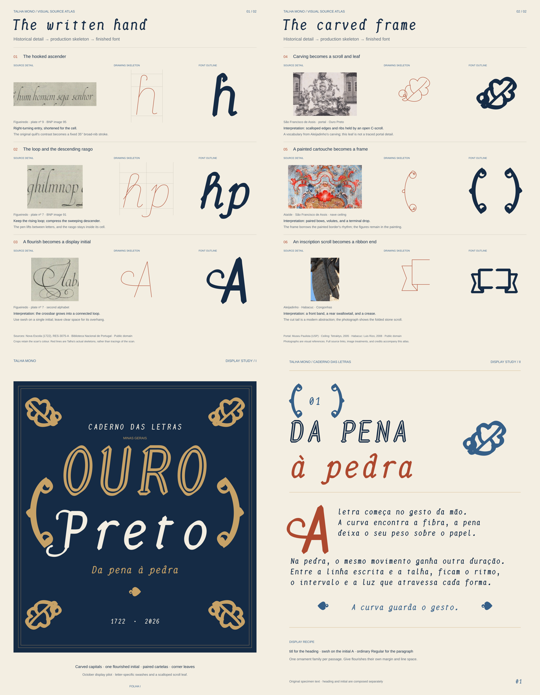

# Talha Mono: source atlas and display studies

The [complete beta.7 stem trial](beta7.md) integrates the selected recipes in
all 20 faces, reduces SS11 lookup size, and adds paired letterform/spacing
review with full-family audits and a four-condition native proof.

The [next-step research after beta.6](next-steps-after-beta6.md) turns the
current study results into an ordered implementation and renderer-validation
plan, with primary references and local shaping/serialization probes.

The [reading reviewer and cross-style stem study](reading-review.md) add a
portable personal comparison tool, a refined t/l/1 trial and Ghostty/fontconfig
resolution evidence. The beta.6 candidate font bytes are unchanged.

The [beta.6 spacing review](beta6.md) refines the optional contextual treatment
with contour guards, all-style measurements and a separate reading corpus.

The [beta.5 feature review](beta5.md) contains the implemented contextual
accent corrections, optional SS11 spacing, whole-run measurements and new
reading proofs. The historical display studies remain below.

The [local beta.4 review](beta4.md) adds the narrow-letter experiments,
native reading proofs, full builds and QA. The atlas and compositions below
are now rendered from that candidate.

[Next-step research](next-steps-research.md) records primary sources,
contextual accent failures reproduced in both baseline and candidate, and
the ordered plan for correctness, spacing and reading experiments.

Studies, October 2026. The atlas follows six connections from a historical
detail through the font's production skeleton to the finished outline. The two
display sheets put those forms to work as a title page and a chapter opening.

The [21 October display pilot](pilot.md) develops three capital swashes, a
scalloped scroll leaf, and folded ribbon ends, with three studies per motif
and proofs at 48, 96, and 192 px. The atlas and display sheets below now show
the selected pilot drawings.

| Sheet | Preview | Editable vector |
|---|---|---|
| The written hand: ascenders, corsiva, initial | [PNG](atlas-letters.png) | [SVG](atlas-letters.svg) |
| The carved frame: leaf, cartela, ribbon | [PNG](atlas-ornament.png) | [SVG](atlas-ornament.svg) |
| Ouro Preto: a title page | [PNG](display-folha.png) | [SVG](display-folha.svg) |
| Da pena à pedra: a chapter opening | [PNG](display-chapter.png) | [SVG](display-chapter.svg) |



## How to read the atlas

The left column contains crops of the actual sources, retaining their colour.
The middle column uses paths from `letters.py`, `corsiva.py`, `caps.py`, and
`ornament.py`. The right column contains outlines exported from the selected
OTF, including its `swsh` alternate where indicated. The two columns can differ
slightly because the finished font also has curve fitting and hinting.

The source-to-form relationships have different degrees of closeness:

- **The Regular's hooked ascender:** an adaptation of plate nº 9. The tall,
  fine quill entry becomes a compact hook written with Talha's broad nib.
- **The Italic's loop and rasgo:** adaptations of the cursiva on plate nº 7.
  Loop height and descender reach are restricted by the monospace cell.
- **The swash initial:** an interpretation of plate nº 7's flourished capitals.
  Talha's `A` grows an open loop out of its own crossbar.
- **The scroll leaf:** an interpretation of the portal's carved vocabulary.
  The scalloped font leaf is a new construction, rather than a traced leaf
  identified in the photograph.
- **The cartela:** an interpretation of the ceiling's curved painted borders,
  reduced to two reusable frame halves.
- **The ribbon:** an abstraction of the prophets' inscribed, folded stone
  scrolls. The swallowtail is Talha's design choice; it is not evidence of
  that exact cut in the photographed scroll.

The atlas makes the translation visible, including the distance between the
historical sources and the contemporary forms. The old writing models and the
later architecture are separate references brought together in this font.

## The display treatment

**Folha I** uses a dark blue field, gilded inline capitals for *OURO*, a single
flourished `P` followed by the corsiva for *Preto*, paired cartelas, and four
directional leaves. The leaves point outward to hold the corners. The gold
comes from the existing specimen's palette; the paper colour supports a
lighter editorial setting.

**The chapter opening** uses the same palette with more paper showing. A
framed chapter number introduces a carved heading; a red corsiva supplies the
second line. A flourished `A` has its own box beside three lines of ordinary
Regular. The paragraph and closing sentence are original specimen text.

The treatment uses `titl`, `swsh`, and Unicode ornaments. The selected pilot
redraws three swash capitals, eight leaf forms, and two ribbon ends within
those existing features and mappings.

Suggested settings for reuse:

| Element | Setting | Spacing |
|---|---|---|
| Main heading | Regular + `titl` | 96–180 px; keep the inline groove visible |
| Flourished initial | Regular + `swsh` on one capital | Reserve a separate box for its ink overhang |
| Secondary line | Italic | About half to two-thirds of the main heading size |
| Cartelas | `❨` and `❩` | Compose each half separately around the content |
| Corner leaves | U+1F650–1F653 | Use the four directional forms; preserve their aspect ratio |
| Paragraph | Regular | Use the normal text features and an ordinary reading size |

In CSS, enable `font-feature-settings: "titl" 1` on the heading, and
`font-feature-settings: "swsh" 1` on a span containing only the initial.
Give that span enough margin and line space for the flourish. The frame halves
and leaves are separate characters. Display features need an application that
supports OpenType features.

## Sources and image credits

The checked-in reference images make regeneration independent of the network.
[sources.json](sources.json) records original URLs, file hashes, treatments,
and crop coordinates, in pixels of the local image.

| Local image | Work and source | Credit and status |
|---|---|---|
| [Plate nº 7](sources/figueiredo-plate7.jpg) | Figueiredo, *Nova Escola* (1722), [BNP RES-3075-A](https://purl.pt/107), digitised image 91 | Biblioteca Nacional de Portugal; public domain |
| [Plate nº 9](sources/figueiredo-plate9.jpg) | Same book and collection, digitised image 95 | Biblioteca Nacional de Portugal; public domain |
| [Portal](sources/aleijadinho-portal.jpg) | [São Francisco de Assis, Ouro Preto](https://commons.wikimedia.org/wiki/File:Igreja_de_S%C3%A3o_Francisco_de_Assiz_%28P%C3%B3rtico_e_Escultura_do_Aleijadinho%29_Ouro_Preto_-_Minas_Gerais%29.jpg), archival print | Public domain / Museu Paulista (USP) Collection; reproduction credited to José Rosael/Hélio Nobre/Museu Paulista da USP |
| [Ceiling](sources/ataide-ceiling.jpg) | Ataíde, [ceiling of São Francisco de Assis](https://commons.wikimedia.org/wiki/File:Ataide-teto.jpg), Ouro Preto | Tetraktys, 2005; public-domain reproduction, as marked on the source page |
| [Habacuc and scroll](sources/habacuc-scroll.jpg) | Aleijadinho, [Habacuc at Congonhas](https://commons.wikimedia.org/wiki/File:HabacucProfeta.jpg) | Luis Rizo, 7 July 2008; public-domain dedication; Commons version with watermark removed by Tamba52 |

The letters' documented relationship to Brazilian brotherhood manuscripts is
discussed in [Márcia Almada (2011)](https://revistaseletronicas.pucrs.br/navegacoes/article/view/10177).
These photographs are reference material selected for this atlas, not a claim
that each exact photograph was used during the font's original development.

## Regenerate

From the repository root, after installing the normal requirements, generate
the pilot fonts and matching illustrations:

```sh
python tools/swash_pilot.py
python tools/design_atlas.py --fonts build/swash-pilot/selected
python tools/design_atlas.py --fonts build/swash-pilot/selected --svg-only --out /tmp/talha-design
```

After a full font build, `python tools/design_atlas.py` uses `build/`.
PNG rendering also needs `rsvg-convert` (librsvg). `font-provenance.json`
records the names, versions, and SHA-256 hashes of the OTFs used. Talha text
is stored as vector paths; explanatory labels use DejaVu Sans. The SVGs embed
their source-image crops and can be opened without installing Talha Mono.

The exporter handles the single substitutions in Talha's `titl` and `swsh`.
It places characters at their font advances; it is a specimen exporter,
not a general-purpose OpenType shaping engine. For documents and applications,
use the font with the application's normal shaping engine.
