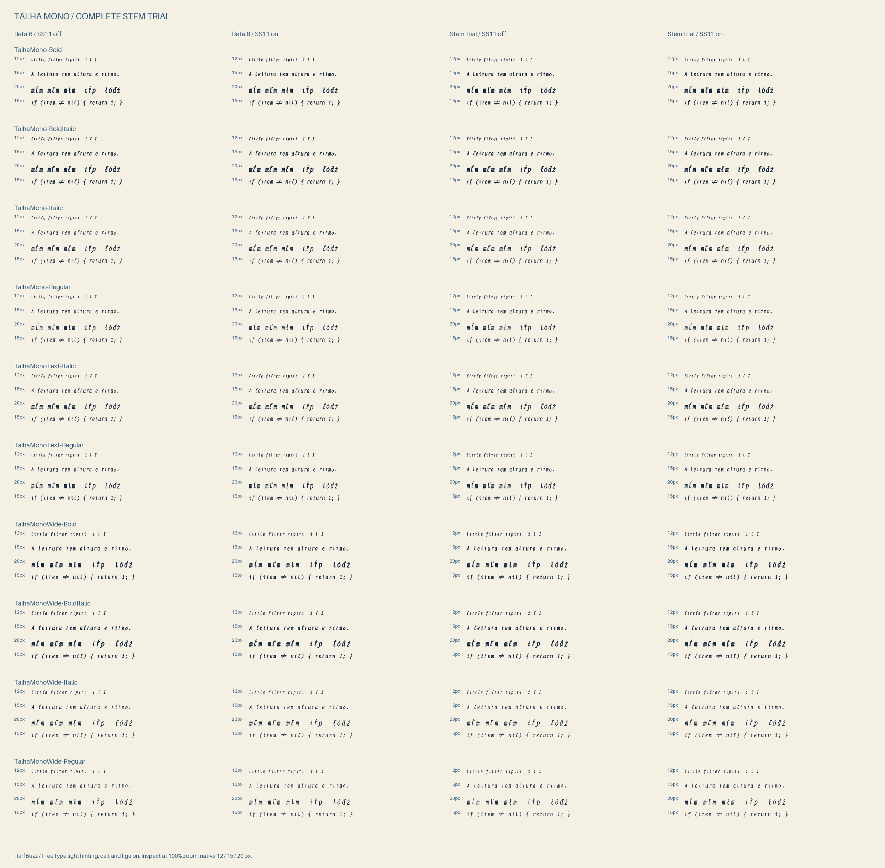

# Talha Mono: refined stems, beta.7

23 October 2026. The screened `t/l` 20-unit and `1` 10-unit recipes now run
through the complete build. On 24 October the user chose them for release:
1.0.0-beta.7 ships them in every face under the ordinary family names (see
[Release](#release)). The trial sections below keep their original wording;
"Stem Trial" names refer to the reviewed trial copies.



The proof shows beta.6 and the stem trial with SS11 independently off/on in
all ten physical styles. Inspect the original image at 100% zoom. The
12/15/20 px rows use HarfBuzz and FreeType light hinting, with calt/liga on.

## Complete recipe integration

`tools/drawing_catalog.py` creates per-build catalogs instead of changing the
global roman drawings when building italic. `tools/stem_recipes.py` applies
the shared adjustments in the original coordinate grid; lowercase height
mapping happens once. `lslash` inherits the selected `l` before crossing it.

Accents, healing forms, SS11 variants, hints and NF copies are rebuilt from
that catalog. The [family audit](measurements/beta7-family-audit.json) finds
exactly 55 changed CFF programs per face, all within the declared stem family.
Unrelated outlines, shared CFF hint resources, glyph IDs, Unicode mappings,
advances, inherited GSUB features and combining-mark anchors are protected.
Default base anchors can change only within the stem family. The plain
`t/l/1` programs exactly match the screened isolated study in all faces.

Inherited `cv10` forms (`l.alt`/`lslash.alt`), `cv02` (`one.alt`), and
`one.numr`/`one.dnom` retain their separate upstream designs. They have no
Talha stem recipe; the audit protects them from accidental replacement.

All 20 baseline-control rebuilds are table-identical to beta.6, allowing only
timestamp/checksum normalization ([control audit](beta6-control-audit.txt)).
The final compact trial's Regular and NF Regular were also rebuilt through
the source pipeline with identical tables
([reproduction audit](beta7-reproduction-audit.txt)).

## Smaller contextual lookup

SS11's newly generated outputs are unencoded and produced only by its
forward lookup. They can occur behind the cursor after substitution, but
cannot be in its unprocessed lookahead. The trial removes those unreachable
right-side class members and empty rules, retaining shifted left neighbors.
The optimizer rejects encoded outputs, other features producing them,
reverse lookups and unexpected contextual structures.

The resulting copies change only GSUB. Across ten styles,
[447,600 comparisons](measurements/beta7-shaping-equivalence.json) preserve
glyph IDs, clusters, advances and offsets. Inputs include every lowercase
ASCII triple, deterministic extended Latin and supported decompositions,
long runs, prose/code, marks, eight feature combinations and en/pt/tr probes.
This corpus is strong regression evidence; it is not exhaustive Unicode proof.

| Regular trial | Original classes | Pruned lookahead |
|---|---:|---:|
| OTF bytes | 1,801,132 | 1,482,380 |
| GSUB bytes | 881,622 | 562,870 |
| SS11 on, median ms | 2.503 | 2.044 |
| SS11 off, median ms | 0.214 | 0.213 |

[Benchmark details](measurements/beta7-shaping-cost.json): HarfBuzz 14.6.0,
2,040 characters, five interleaved batches of 20 shapes after warm-up,
fresh buffers included. The roughly 18% file and 36% GSUB reductions are
measured byte counts; the timing improvement is local to this workload.
The older coverage-format probe saved less and was slower, so it was not used.

## Measurement and font QA

- [Legibility gate](beta7-regression.md): all ten styles pass; no confusable
  pair becomes more than 0.01 worse. No new waiver was added.
- [Expanded context audit](measurements/beta7-context-check.json): all 20
  faces pass. Nine mark samples run through four independent calt/SS11
  combinations, including an uncomposed stack on a shifted `t`; code samples
  run through eight calt/SS11/liga combinations. NFC/NFD, contextual base
  attachment, coverage and ordinary/NF parity checks pass.
- [Four-condition measurements](measurements/beta7-four-conditions.md):
  1,530 text/size/style cases, 6,120 rendered conditions, no changed columns
  or added cross-cluster overlaps. Mean gap CV is diagnostic, not reading speed.
  Regular SS11 changes 0.1527 → 0.1524; Text Regular 0.1563 → 0.1536;
  Bold worsens slightly, 0.1667 → 0.1676. Improvement is not uniform.
- FontBakery 1.1.0: all six families, zero ERROR/FATAL/FAIL. Ordinary
  [normal](qa/beta7-qa-normal.md)/[wide](qa/beta7-qa-wide.md)/[text](qa/beta7-qa-text.md)
  have 24/24/12 warnings; NF
  [normal](qa/beta7-qa-normal-nf.md)/[wide](qa/beta7-qa-wide-nf.md)/[text](qa/beta7-qa-text-nf.md)
  have 28/28/14. The existing CI exclusions `case_mapping` and
  `opentype/monospace` remain; network checks were skipped.

Automated checks: 253 Python tests and nine JavaScript model tests pass;
mypy reports no issues in 71 source files. Live UI validation is separate.

## Paired reading review

`build/beta7-review/` contains 40 hash-checked font copies and a portable UI.
**Spacing** compares one version with SS11 off/on; **Letterforms** compares
beta.6 against the trial at a shared SS11 setting. Both keep calt/liga on.
Assignments are randomized and hidden until a preference has been saved.
The reviewer waits for both font loads and a browser frame before enabling
ratings. JSON v2 records each pane's exact font hash and feature settings,
alongside size, ground, text, preference and reveal state.

```sh
python -m http.server 8766 --bind 127.0.0.1 --directory build/beta7-review
# Open http://127.0.0.1:8766 and inspect at 100% browser zoom.
```

Download observations before reloading. Observations remain in page memory;
the package excludes user exports. Repeated passages support clarity and
preference judgments, not a reading-speed claim.

[Ghostty/fontconfig resolution](measurements/beta7-terminal-resolution.md)
passes for all 40 exact files using a private fontconfig set and no font
installation. This checks face/codepoint resolution only.

The reviewer was tested in Chrome on 24 October. Both modes load the right
file pairs and feature states; rapid face changes settle on the last face;
unchanged glyphs render pixel-identical between versions while `t/l/1`
differ; at 160 px SS11 moves the `i`s of "tipiti" by ±3.2 px (40 units at
2000 UPM), matching HarfBuzz. Rating, reveal, A/B reset, hash-mismatch
handling, Unicode and mark editing, dark ground, 12–24 px and a 390 px layout
all behave as intended, with no console errors. Small open issues: Tab moves
focus instead of inserting a tab; changing the sample discards edits; the
disabled spacing menu can show a stale value; the export filename uses the
UTC date; a reveal lasts until **New A/B order**. Editor and terminal pixels,
caret, selection and fallback are still unchecked.

## Reproduce and review

```sh
# The normal build now produces the refined stems and the compact lookup:
TALHA_BUILD_DIR=build/beta7-rebuilt JOBS=2 HINT_JOBS=1 bash build.sh
python tools/reading_review.py --fonts build/beta6-baseline --candidate build/beta7-compact --out build/beta7-review
python tools/candidate_proof.py --base build/beta6-baseline --new build/beta7-compact
pytest
node tests/test_reading_review.mjs
python -m mypy tools
```

The local `dist/TalhaMono-1.0.0-beta.7-stem-trial.zip` contains all 20 trial
faces and the audit documentation. The paired reviewer is
`dist/TalhaMono-1.0.0-beta.7-reading-review.zip`; both have SHA-256 sidecars.
Neither is installed or published. Next: perform personal comparisons in both
review modes, check actual editor/terminal behavior, and decide whether to
adopt the stem profile or retain beta.6 defaults.

## Release

The user chose the refined stems on 24 October 2026. Their exported blind
ratings were two Spacing comparisons, Regular (beta.6 drawings) and Wide Bold
(trial drawings) at 15 px, and both preferred SS11 on. No letterform rating
was recorded, so the stem choice is the user's judgment, not a measured
preference. SS11 stays opt-in for this release.

`--refined-stems`, `TALHA_STEM_PROFILE` and the Stem Trial names are gone;
the catalog draws the refined stems by default and the guarded SS11 lookup
is always pruned. The release build matches the reviewed trial in every
face: identical charstrings, glyph order, GSUB, GPOS, GDEF, metrics and
hinting tables. Only `name`, `head` and the CFF name strings differ.

- [Legibility gate against beta.3](beta7-release-gate.md), the fonts CI
  compares a release with: pass in all ten styles, no waiver; the most
  confusable pair improves in every style.
- Contextual shaping and advances: 20 faces pass.
- FontBakery 1.1.0 universal profile, six families: zero ERROR/FATAL/FAIL;
  [normal](qa/beta7-release-qa-normal.md)/[wide](qa/beta7-release-qa-wide.md)/[text](qa/beta7-release-qa-text.md)
  24/24/12 warnings, NF [normal](qa/beta7-release-qa-normal-nf.md)/[wide](qa/beta7-release-qa-wide-nf.md)/[text](qa/beta7-release-qa-text-nf.md)
  28/28/14, the same as the trial.
- 256 Python tests and mypy pass.
